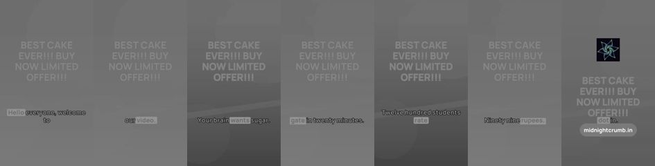
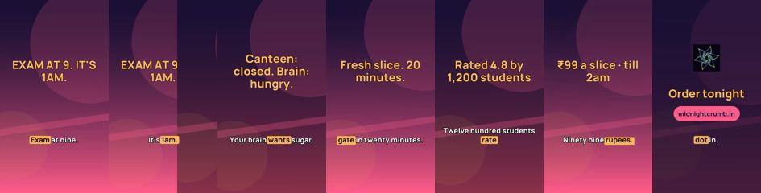
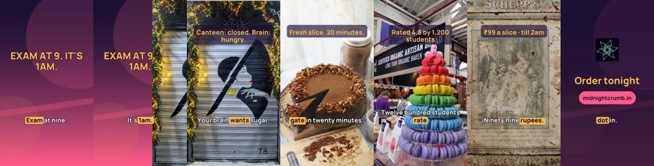

# Reel judge: does it tell bad from good?

Run 2026-10-25 03:48 · vision model `meta/llama-4-maverick-17b-128e-instruct-maas` · 3 blind judgements per variant (temperature 0.7) · `make reel-eval` · source `engine/reel_eval.py`

Same storyboard rendered three ways. The judge sees only the frames and the script, never the variant name.

| Variant | Vision model mean (0–10) | Final with measured checks | Stop-scroll | Scene variety | Real imagery |
|---|---|---|---|---|---|
| broken | 3.21 ± 0.85 | 3.21 ± 0.85 | 1.0 | 0.05 | 0% |
| placeholder | 6.58 ± 0.36 | 6.21 ± 0.36 | 4.7 | 0.10 | 0% |
| real | 7.25 ± 0.12 | 7.25 ± 0.12 | 6.3 | 0.27 | 67% |

**Vision model alone ranks broken < placeholder < real: PASS**  
**Final score ranks broken < placeholder < real: PASS**

## broken

> This Reel is a mess, looks like an AI-generated slideshow with a bland template.

Measured: scenes look alike (visual variety 0.05 < 0.12); only 0% of scenes show real photos or footage

## placeholder

> This Reel is a basic template with decent messaging but lacks visual appeal.

Measured: scenes look alike (visual variety 0.10 < 0.12); only 0% of scenes show real photos or footage

## real

> This Reel effectively communicates the value proposition but lacks a cohesive visual style.

Photos (Openverse, CC): "Shutter of Closed Shop, Via Bernardo Tanucci, Pisa, Tuscany, Italy" by Stuart Smith. is licensed under CC BY-SA 2.0. To view a copy of this license, visit https://creativecommons.org/licenses/by-sa/2.0/.; "Free chocolate cake slice image" is marked with CC0 1.0. To view the terms, visit https://creativecommons.org/publicdomain/zero/1.0/.; "Rainbow macarons" by Ruth and Dave is licensed under CC BY 2.0. To view a copy of this license, visit https://creativecommons.org/licenses/by/2.0/.; "Cake Box Texture" by 'Playingwithbrushes' is licensed under CC BY 2.0. To view a copy of this license, visit https://creativecommons.org/licenses/by/2.0/.

